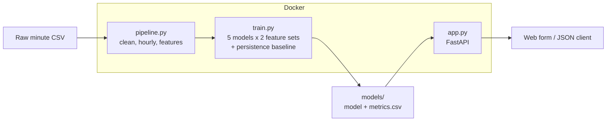

# Hourly Solar Irradiance Estimation in Kenya (Narok, Dec 2019 – Dec 2020)

This project estimates hourly Global Tilted Irradiance (GTI, W/m²) at the World Bank solar measurement site in Narok, Kenya, from weather measurements and time. Five models (Linear Regression, Random Forest, Gradient Boosting, XGBoost, Keras MLP) are compared on two feature sets against a persistence baseline. The best weather-only model is served through a FastAPI API in a Docker container, with a small web form.

**What the model does:** it estimates the GTI for an hour from weather measured in that same hour. This is nowcasting, useful for filling gaps in measured irradiance and for resource assessment. It does not forecast future hours.

## Architecture



## Repository layout

```
Dockerfile, docker-compose.yml, requirements.txt
data/raw/narok_2019.csv        <- raw dataset (included in the repository)
data/processed/hourly.csv      <- written by pipeline.py
models/                        <- served model, model_info.json, metrics.csv
src/config.py                  <- paths, column names, split date, feature lists
src/pipeline.py                <- ingestion, cleaning, hourly aggregation, features
src/train.py                   <- training, evaluation, model selection
src/app.py, src/index.html     <- API and web interface
```

## Data

World Bank / ESMAP solar measurement campaign, Narok, Kenya: file `solar-measurements_kenya-narok_world-bank_year1_qc.csv`, available from the World Bank Energy Data portal (energydata.info). It has 567,360 one-minute records from 4 December 2019 to 31 December 2020, with DHI, two GHI pyranometers, three GTI sensors (`gti_clean`, `gti_soil`, `gti_monthly`), air temperature, humidity, pressure, precipitation, wind speed and direction, and a sensor-cleaning flag. Timestamps are day-first (`DD/MM/YYYY HH:MM`).

**Target:** `gti_clean`, the GTI sensor that is kept clean.

**Excluded to prevent leakage:** DHI, both GHI sensors, `gti_soil` and `gti_monthly`. They measure almost the same quantity as the target at the same moment.

**1. Get the code**

```bash
git clone https://github.com/MilcahMaina/solar-gti.git
cd solar-gti
```

**2. Start Docker Desktop** and wait until it shows *Engine running*.

**3. Rebuild the data and retrain the models** (

```bash
docker compose run --rm --build train
```

This runs `src/pipeline.py`, which turns the raw minute CSV into `data/processed/hourly.csv`, and then `src/train.py`, which trains all the models, prints the results table and saves the served model and `metrics.csv` to `models/`.

**4. Start the API**

```bash
docker compose up --build api
```

Open http://localhost:8000, enter weather values and click *Estimate irradiance*. The interactive API docs are at http://localhost:8000/docs. Press `Ctrl+C` to stop.

Without Docker (Python 3.12):

```bash
python -m pip install -r requirements.txt
cd src
python pipeline.py
python train.py
python -m uvicorn app:app --port 8000
```

`python -m` is used because some managed Windows machines block `pip.exe` and `uvicorn.exe` from running directly.

The trained model is committed in `models/`, so `docker compose up --build api` works without the data file.

## Using the API

Open http://localhost:8000 for the form, http://localhost:8000/docs for the interactive API docs, or:

```bash
curl -X POST http://localhost:8000/predict -H "Content-Type: application/json" \
  -d '{"time":"2020-11-15T12:00","temperature":24,"humidity":45,"pressure":810,"precipitation":0,"wind_speed":3,"wind_direction":90}'
# {"gti_wm2": ..., "model": "XGBoost"}
```

Inputs use the same clock as the source file.

## Pipeline

| Step | What it does | Why |
|---|---|---|
| Column selection | Reads only the target GTI sensor, weather columns and the cleaning flag | Removes leakage columns |
| Cleaning flag | GTI set to missing while sensors are being cleaned | Readings during cleaning are not physical |
| Duplicates | Duplicate timestamps dropped | |
| Hourly aggregation | Mean per hour; rain summed; wind direction averaged as a vector | Minute data is noisy; a plain mean of 359° and 1° would give 180° |
| Minimum coverage | An hour needs at least 30 valid GTI minutes | Avoids hours built from a few readings next to a maintenance gap |
| Missing weather | Interpolated across gaps of up to 3 hours; longer gaps dropped | Short gaps are safe to fill; long maintenance gaps are not |
| Night values | Small negative GTI clipped to 0 | Sensor offset at night |
| Split | Train 5 Dec 2019 – 30 Sep 2020, test 1 Oct – 31 Dec 2020 | Time-based; no future information in training |

**Row counts**

| Stage | Rows |
|---|---|
| Raw minute records | 567,360 |
| After de-duplication | 567,360 |
| Calendar hours | 9,457 |
| Hours with at least 30 valid GTI minutes | 9,248 |
| Final modelling rows (complete weather and GTI history) | 7,949 |
| Train / test | 5,741 / 2,208 |

## Feature sets

- **Weather (served):** temperature, humidity, pressure, precipitation, wind speed, wind direction, hour, day of year.
- **Weather + lags (comparison):** the above plus cyclical hour and day-of-year encodings, GTI one hour earlier, GTI 24 hours earlier, and the 3-hour rolling mean of past GTI.

Both sets use the same rows, so the comparison is fair.

## Results

Test period: October to December 2020 (2,208 hours). Daylight metrics use hours with GTI > 10 W/m². Skill is 1 − RMSE_model / RMSE_persistence on daylight hours; positive means better than persistence.

| Features | Model | MAE | RMSE | R² | MAE (day) | RMSE (day) | R² (day) | Skill (day) |
|---|---|---|---|---|---|---|---|---|
| baseline | Persistence (t−24h) | 52.0 | 115.3 | 0.880 | 104.6 | 163.7 | 0.743 | 0% |
| weather | Linear Regression | 147.9 | 195.0 | 0.657 | 165.8 | 212.5 | 0.567 | −30% |
| weather | Random Forest | 44.8 | 96.6 | 0.916 | 87.8 | 136.1 | 0.823 | 17% |
| weather | Gradient Boosting | 57.8 | 105.8 | 0.899 | 102.5 | 146.7 | 0.794 | 10% |
| weather | **XGBoost (served)** | 46.2 | 94.3 | 0.920 | 88.1 | 133.1 | 0.830 | **19%** |
| weather | MLP | 117.6 | 170.2 | 0.739 | 205.0 | 234.8 | 0.472 | −43% |
| weather + lags | Linear Regression | 44.9 | 77.3 | 0.946 | 74.8 | 107.1 | 0.890 | 35% |
| weather + lags | **Random Forest** | 31.1 | 71.5 | 0.954 | 62.2 | 101.5 | 0.901 | **38%** |
| weather + lags | Gradient Boosting | 34.2 | 73.4 | 0.951 | 66.5 | 104.1 | 0.896 | 36% |
| weather + lags | XGBoost | 34.5 | 74.1 | 0.950 | 66.9 | 105.0 | 0.894 | 36% |
| weather + lags | MLP | 39.3 | 76.2 | 0.948 | 76.2 | 108.0 | 0.888 | 34% |

Full output: `models/metrics.csv`.

**Interpretation**

1. **Weather-only tree models beat persistence, modestly.** XGBoost improves daylight RMSE by 19% over "same hour yesterday". Random Forest is close at 17%.
2. **Linear Regression and the MLP fail without lags.** With only a raw hour number, they cannot learn the bell-shaped daily irradiance curve, which tree models capture by splitting on hour. Both end up worse than persistence.
3. **GTI history matters most.** Adding lag features lifts every model to 34–38% skill. Linear Regression and the MLP gain the most, so the cyclical encodings and lags supply the structure they were missing.
4. **Night hours inflate R².** XGBoost's R² is 0.92 on all hours but 0.83 on daylight hours. Daylight metrics are the honest measure.

## Why the API serves the weather-only model

The lag models are more accurate, but they need measured GTI from previous hours. A user of the form doesn't have it, and feeding the model its own past predictions would compound errors. The served model therefore uses weather and time only, selected by lowest test RMSE among weather-only models. The lag results show how much an irradiance history would add where one is available.

## Technique choices

- **Linear Regression:** transparent baseline.
- **Random Forest, Gradient Boosting, XGBoost:** capture non-linear interactions between weather and time of day with little preprocessing. XGBoost is tuned with `GridSearchCV` and `TimeSeriesSplit` (5 folds that respect time order).
- **Keras MLP (Adam, dropout, early stopping, scaled inputs):** tests whether a neural network adds value on about 5,700 tabular training rows.
- **Persistence baseline:** the standard reference in solar forecasting; a model is only useful if it beats it.

**Not used**

- **LSTMs / Transformers:** too little data (one site, about 13 months) for sequence models to beat tree ensembles, and the lag features already supply the short history.
- **CNNs / satellite imagery:** outside the scope of a single ground station.
- **Unsupervised methods:** the problem is supervised regression with a measured target.

## Reproducibility notes

- All random seeds are fixed (`RANDOM_STATE = 42`). Running the pipeline in Docker reproduced the local results exactly for all models except the MLP, which differed in the second decimal place because of floating-point differences between Windows and Linux.
- XGBoost runs with `n_jobs=1`. With `n_jobs=-1` it stalled inside the Docker container, because it tried to use more CPU threads than the container was given.

## Limitations

- One site and one campaign year: the model should not be assumed to transfer to other locations or years.
- The test period (October to December) covers only part of the seasonal cycle.
- Inputs are measured at the same hour as the target, so the model estimates current irradiance rather than forecasting future hours.
- Wind direction and some weather variables have long maintenance gaps; 1,299 hours with valid GTI were dropped because weather or GTI history was incomplete.
